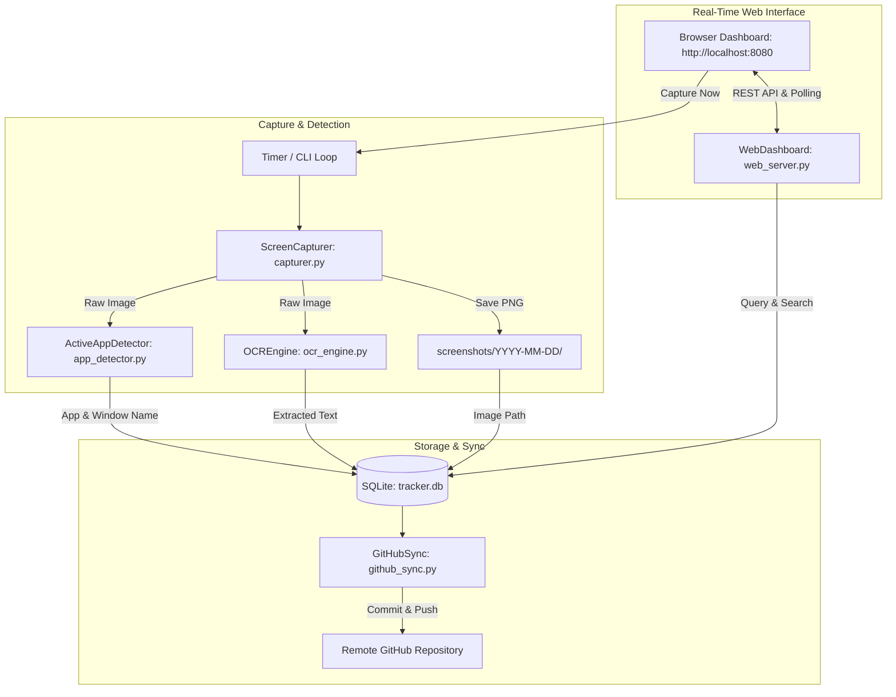

# GEMINI.md - Screen Tracker Architecture & Context

## Project Overview

**Screen Tracker** is a continuous desktop and device activity tracker written in Python. It captures screen frames at configurable intervals, detects the currently active foreground application and window title, extracts on-screen text using Tesseract OCR, logs full structured records into a local SQLite database, and automatically commits and pushes captures to a GitHub repository.

Additionally, it provides a built-in real-time web dashboard running on Python's native `http.server` with live delta polling, search over OCR text, and an on-demand capture trigger.

---

## Architecture Diagram



---

## Core Components & Modules

### 1. `config.py`
- Holds application configuration using Python `@dataclass`.
- Reads settings from environment variables (`.env`) with sensible defaults.
- Key properties: `interval_seconds`, `output_dir`, `db_path`, `store_image_blob`, `ocr_language`, `git_enabled`, `git_remote`, `git_branch`.

### 2. `capturer.py`
- Handles multi-backend screen grabbing:
  - **Desktop (Win, macOS, Linux X11)**: Uses `mss` for high-performance screen capture.
  - **Pillow ImageGrab**: Secondary desktop capture fallback.
  - **Android (Termux)**: Attempts root `screencap` or `termux-api`.
  - **Headless Fallback**: Renders high-resolution 960x540 visual frames with live terminal metadata, active session details, and OCR-friendly text using Pillow / standard library.
- Organizes screenshots into date-based subfolders (`screenshots/YYYY-MM-DD/`).
- Returns ISO timestamps, absolute paths, raw bytes, and Pillow Image objects.

### 3. `app_detector.py`
- Cross-platform active window and opened application name resolution:
  - **Windows**: `ctypes` user32/kernel32 APIs (`GetForegroundWindow`, `GetWindowTextW`, `QueryFullProcessImageNameW`).
  - **macOS**: AppleScript `System Events` for frontmost application and window title.
  - **Linux (X11 & Wayland)**: `xdotool`, `xprop` (`WM_CLASS`, `_NET_WM_NAME`), and `hyprctl`.
  - **Android**: `dumpsys window` / foreground activity inspection.
  - **Headless**: Returns safe generic defaults without crashing.

### 4. `ocr_engine.py`
- Text extraction pipeline via Tesseract OCR (`tesseract` CLI and `pytesseract`).
- Preprocessing: Grayscale conversion, contrast enhancement (`ImageEnhance.Contrast`), and sharpening (`ImageFilter.SHARPEN`).
- Fallback: Direct command-line binary invocation if `pytesseract` is absent.

### 5. `database.py`
- SQLite database wrapper (`TrackerDatabase`).
- Table `screenshots`:
  - `id`: INTEGER PRIMARY KEY AUTOINCREMENT
  - `timestamp`: TEXT (ISO 8601 UTC)
  - `app_name`: TEXT
  - `window_title`: TEXT
  - `extracted_text`: TEXT
  - `image_path`: TEXT (Absolute or canonical path)
  - `image_blob`: BLOB (Optional direct binary storage)
  - `github_pushed`: INTEGER (0 or 1)
  - `commit_hash`: TEXT (Git commit SHA)
  - `created_at`: TEXT
- Indices: `timestamp`, `app_name`, `github_pushed`.
- Queries: `get_filtered()` (search with pagination & delta sync), `get_by_id()`, `get_stats()`, `get_unique_apps()`.

### 6. `github_sync.py`
- Automates staging, committing, and pushing captures to GitHub.
- Uses `git` binary and credentials from `gh auth setup-git` or SSH keys.
- Updates database records with commit hash and push status.

### 7. `web_server.py`
- Built-in HTTP server using `http.server.ThreadingHTTPServer` (zero external framework dependencies).
- Features:
  - Modern dark-mode responsive dashboard.
  - Live auto-refresh polling every 3 seconds for delta updates (`/api/poll?since_id=X`).
  - Real-time search across OCR text, window titles, and app names.
  - Modal lightbox viewer with full image inspection and "Copy OCR Text" button.
  - On-demand "📸 Capture Now" button (`POST /api/capture_now`).

### 8. `main.py`
- CLI entry point and process orchestrator.
- Supports daemon mode, single-shot mode (`--once`), web dashboard flags (`--web`, `--web-only`, `--web-port`), and CLI query utilities (`--query`, `--stats`, `--recent`).

---

## REST API Reference

| Method | Endpoint | Description |
|---|---|---|
| `GET` | `/` | Web dashboard single-page interface |
| `GET` | `/api/stats` | JSON summary: total captures, pushed count, top apps |
| `GET` | `/api/apps` | List of distinct active application names |
| `GET` | `/api/screenshots` | Filtered screenshots (`?query=...&app=...&limit=40&offset=0`) |
| `GET` | `/api/poll?since_id=N` | Real-time delta update for captures newer than `since_id` |
| `GET` | `/api/screenshot/<id>/image` | Direct PNG image stream with cache-busting support |
| `POST` | `/api/capture_now` | Triggers an immediate capture cycle |

---

## Developer Workflows

### Running Tests
```bash
python test_pipeline.py
```

### Running Capture Daemon with Web Dashboard
```bash
python main.py --interval 60 --web
```

### Running Web Viewer Only
```bash
python main.py --web-only --web-port 8080
```

### Running with GitHub Auto-Sync
```bash
python main.py --interval 60 --web --git --remote origin --branch main
```
