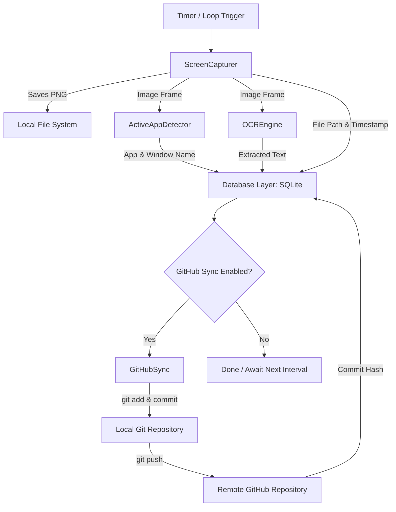

# Screen Tracker (OCR & GitHub Auto-Sync)

A robust, cross-platform Python application that continuously captures screenshots over time, detects the active foreground application name, extracts on-screen text via OCR (Tesseract), stores full records in an SQLite database, and automatically commits and pushes the screenshots to a GitHub repository.

---

## Features

- **Automated Periodic Captures**: Configurable capture intervals (e.g. every 30s, 60s, 5m) or single-shot execution for cron jobs.
- **Active Window & App Detection**:
  - **Windows**: `ctypes` User32/Kernel32 foreground window and executable resolution.
  - **macOS**: AppleScript `System Events` frontmost application and window query.
  - **Linux**: X11 (`xdotool`, `xprop`) and Wayland (`hyprctl`, `swaymsg`).
  - **Android / Termux**: `dumpsys window` / foreground activity detection with headless fallbacks.
- **OCR Text Extraction**:
  - Powered by Tesseract OCR with automatic image preprocessing (grayscale, contrast boost, sharpening).
  - Works with `pytesseract` or falls back directly to the `tesseract` CLI binary.
- **SQLite Database**:
  - Automatically records timestamp (ISO 8601), app name, window title, extracted text, image path, optional raw image bytes (`BLOB`), and GitHub commit hash.
  - Indexed for fast full-text searching and app breakdown statistics.
- **GitHub Auto-Sync**:
  - Automatically stages new screenshot images, creates timestamped commit messages, and pushes to your specified remote branch.
  - Keeps track of sync state (`github_pushed = 1`, `commit_hash = <SHA>`) inside the database.

---

## Architecture Flow



---

## Directory Structure

```
screen_tracker/
├── app_detector.py      # Active window and process name detection
├── capturer.py          # Screenshot capture engine (MSS / PIL / Screencap)
├── config.py            # Environment & CLI configuration loader
├── database.py          # SQLite database schema, inserts, and search
├── github_sync.py       # Automated Git commit and push pipeline
├── main.py              # CLI entry point and daemon runner
├── ocr_engine.py        # Tesseract OCR and image preprocessing
├── requirements.txt     # Python dependencies
├── .env.example         # Configuration environment template
├── test_pipeline.py     # Comprehensive test suite
└── README.md            # Documentation
```

---

## Installation & Prerequisites

### 1. System OCR Dependency (Tesseract)

Install Tesseract OCR for your operating system:

- **Ubuntu / Debian**:
  ```bash
  sudo apt update && sudo apt install -y tesseract-ocr
  ```
- **macOS (Homebrew)**:
  ```bash
  brew install tesseract
  ```
- **Windows**:
  Download and install from [UB-Mannheim Tesseract Releases](https://github.com/UB-Mannheim/tesseract/wiki).
- **Android / Termux**:
  ```bash
  pkg install tesseract python-pillow
  ```

### 2. Python Dependencies

```bash
pip install -r requirements.txt
```

*(Optional dependencies: `mss`, `pillow`, `pytesseract`, `psutil`, `python-dotenv`)*

---

## Configuration

Copy `.env.example` to `.env` or set environment variables:

```bash
cp .env.example .env
```

| Variable | Default | Description |
|---|---|---|
| `SCREEN_INTERVAL_SECONDS` | `60.0` | Seconds between screenshot captures |
| `SCREEN_OUTPUT_DIR` | `./screenshots` | Folder where screenshot images are saved |
| `SCREEN_DB_PATH` | `./tracker.db` | Path to SQLite database file |
| `SCREEN_STORE_BLOB` | `false` | Set to `true` to store raw image bytes directly inside SQLite |
| `OCR_LANGUAGE` | `eng` | Tesseract language code |
| `GIT_ENABLED` | `false` | Enable automatic Git commit and push |
| `GIT_REMOTE` | `origin` | Remote name (e.g., origin) |
| `GIT_BRANCH` | `main` | Git branch to push screenshots to |
| `GIT_REPO_DIR` | `.` | Git repository root directory |

---

## Usage

### 1. Run with Real-Time Web Dashboard
Captures screenshots and serves a live web UI at `http://localhost:8080`:
```bash
python main.py --interval 60 --web
```

### 2. Run Web Viewer Only (Browse & Search Previous Captures)
Runs just the web dashboard without taking new screenshots:
```bash
python main.py --web-only --web-port 8080
```

### 3. Custom Interval and Direct GitHub Sync
Capture every 30 seconds and automatically push to GitHub `origin/main`:
```bash
python main.py --interval 30 --git --remote origin --branch main
```

### 4. Run a Single Capture (Ideal for Cron)
```bash
python main.py --once
```

### 5. Query Extracted OCR Text from CLI
Search the SQLite database for keywords captured on screen (e.g., code snippets, URLs, or messages):
```bash
python main.py --query "pull request"
```

### 6. View Recent Captures & Statistics
```bash
python main.py --recent 5
python main.py --stats
```

---

## GitHub Setup

To allow the application to automatically push screenshots to your GitHub repository:

1. Initialize git in the folder (or point `--repo-dir` to your cloned repo):
   ```bash
   git init
   git remote add origin git@github.com:USERNAME/REPO_NAME.git
   ```
2. Ensure SSH keys or a GitHub Personal Access Token (credential helper) is configured so `git push` runs non-interactively.
3. Run the tracker with `--git`:
   ```bash
   python main.py --interval 60 --git
   ```

---

## Running the Test Suite

Run the built-in unit and integration test suite:
```bash
python test_pipeline.py
```
